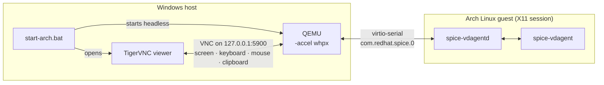

# qemu-arch-on-windows

Run an Arch Linux VM on a Windows host with **QEMU + Windows Hypervisor Platform
(WHPX)**, with a working **two-way clipboard** and a mouse that moves freely in
and out of the VM window. One double-click starts the VM and opens the viewer.

The scripts are the result of debugging this setup end to end. The reasoning
behind each choice is in [docs/troubleshooting.md](docs/troubleshooting.md).

## Why this setup

| Problem | What this repo does about it |
|---|---|
| VirtualBox is slow while Hyper-V / Windows Hypervisor Platform is enabled | QEMU uses Windows Hypervisor Platform directly (`-accel whpx`) |
| QEMU's GTK window has no clipboard on Windows builds (compiled out by default) | QEMU runs headless and serves the screen over **VNC** on `127.0.0.1`, which carries the clipboard |
| Cursor gets lost when moving between monitors | USB tablet + vdagent mouse give an absolute pointer |
| Starting the same disk twice can corrupt it | The launcher only reconnects if the VM is already running |
| Machine-specific paths in scripts | All settings in one git-ignored `config.cmd` |

## How it works



QEMU's built-in `qemu-vdagent` speaks the SPICE agent protocol over a
virtio-serial port, so the standard `spice-vdagent` in the guest handles
clipboard and mouse. No SPICE server or client is involved.

## Repository layout

```
windows/
  start-arch.bat        launcher: starts QEMU (if not running) and opens TigerVNC
  config.example.cmd    all settings, documented; copy to config.cmd
  check-setup.ps1       read-only preflight check of the host and config
guest/
  setup.sh              guest setup: spice-vdagent, optional VirtualBox cleanup,
                        virtio disk, SSH
docs/
  troubleshooting.md            symptoms, root causes, fixes
  migrating-from-virtualbox.md  convert an existing .vdi and keep your install
```

## Requirements

**Windows host**

- [QEMU for Windows](https://qemu.weilnetz.de/w64/), 6.1 or newer (needs the
  `qemu-vdagent` chardev)
- The *Windows Hypervisor Platform* feature, for speed:
  ```powershell
  # PowerShell as administrator, then reboot
  Enable-WindowsOptionalFeature -Online -FeatureName HypervisorPlatform
  ```
- [TigerVNC viewer](https://sourceforge.net/projects/tigervnc/files/stable/):
  the standalone `vncviewer64-<version>.exe` (no installer, no account)

**Guest**

- Arch Linux with a desktop running on **X11** (spice-vdagent's clipboard sync
  mostly does not work on Wayland)

## Quick start

1. **Configure.** Copy `windows\config.example.cmd` to `windows\config.cmd` and
   set the paths to QEMU, the firmware, your disk image and TigerVNC. Set RAM
   and CPU count for your machine.

   Coming from VirtualBox? See
   [docs/migrating-from-virtualbox.md](docs/migrating-from-virtualbox.md).

2. **Check.**
   ```bat
   powershell -ExecutionPolicy Bypass -File windows\check-setup.ps1
   ```
   It verifies paths, QEMU features, WHPX, disk format, RAM/CPU sizing and free
   ports, and it changes nothing.

3. **Start.** Double-click `windows\start-arch.bat`. QEMU starts minimized and
   TigerVNC connects automatically.

4. **Set up the guest.** In a terminal inside your desktop session:
   ```bash
   git clone https://github.com/<you>/qemu-arch-on-windows.git
   cd qemu-arch-on-windows
   bash guest/setup.sh                 # spice-vdagent + checks
   ```
   Optional flags, which can be combined:

   | Flag | What it does |
   |---|---|
   | `--remove-vbox` | Removes VirtualBox Guest Additions left over from a converted disk |
   | `--virtio-disk` | Prepares the initramfs so you can set `DISK_IF=virtio` (faster disk) |
   | `--ssh` | Installs and enables OpenSSH (pair with `SSH_PORT` in `config.cmd`) |

   Log out and back in. Copy and paste now works in both directions.

## Daily use

- **Start or reconnect:** double-click `start-arch.bat` (tip: create a desktop
  shortcut and set *Run: Minimized* in its properties).
- **Close the viewer:** the VM keeps running. Start the launcher again to
  reconnect.
- **Shut down:** from inside Arch (`poweroff` or the desktop menu). QEMU exits
  with the guest.
- **Full screen:** F8 in TigerVNC opens its menu.

## Configuration reference

All options live in `windows\config.cmd`. See
[`config.example.cmd`](windows/config.example.cmd) for the commented version.

| Variable | Example | Notes |
|---|---|---|
| `QEMU` | `C:\Program Files\qemu\qemu-system-x86_64.exe` | |
| `FIRMWARE` | `...\qemu\share\edk2-x86_64-code.fd` | UEFI firmware, opened read-only |
| `DISK` / `DISK_FORMAT` | `C:\VMs\Arch.qcow2` / `qcow2` | |
| `DISK_IF` | `ide` or `virtio` | `virtio` needs `setup.sh --virtio-disk` first |
| `VNCVIEWER` / `VIEWER_ARGS` | `C:\Tools\vncviewer64.exe` | |
| `RAM` | `8G` | At most half of host RAM |
| `SMP` | `8,sockets=1,cores=4,threads=2` | At most half of host threads is a good default |
| `ACCEL` | `whpx` | `whpx,kernel-irqchip=off` if boot hangs at *Switch Root*; `tcg` = no acceleration |
| `XRES` / `YRES` | `2560` / `1344` | Guest resolution |
| `VNC_DISPLAY` | `0` | Port = 5900 + display |
| `SSH_PORT` | `2222` | Empty = off. Forwards `127.0.0.1:<port>` to guest port 22 |
| `EXTRA_ARGS` | | Passed to QEMU as-is |

## Security notes

- VNC listens on **127.0.0.1 only** and has no password, so only programs on
  your own PC can connect. Do not change it to `0.0.0.0` without adding
  authentication.
- The SSH forward is bound to `127.0.0.1` as well.
- Disk images and firmware files are git-ignored. Never commit a VM disk.

## Tested with

- Windows 11 24H2 (build 26100), 8-core / 16-thread CPU, WHPX
- Arch Linux guest, XFCE on X11
- TigerVNC viewer 1.16.2

## License

[MIT](LICENSE)
